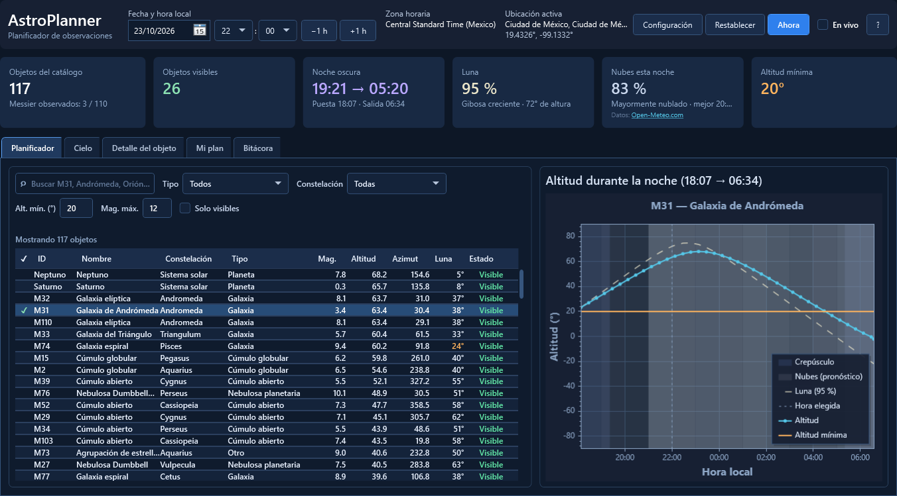
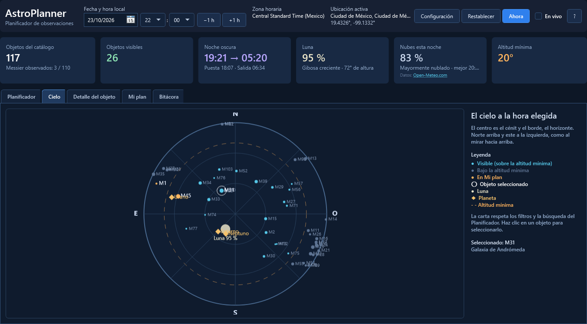
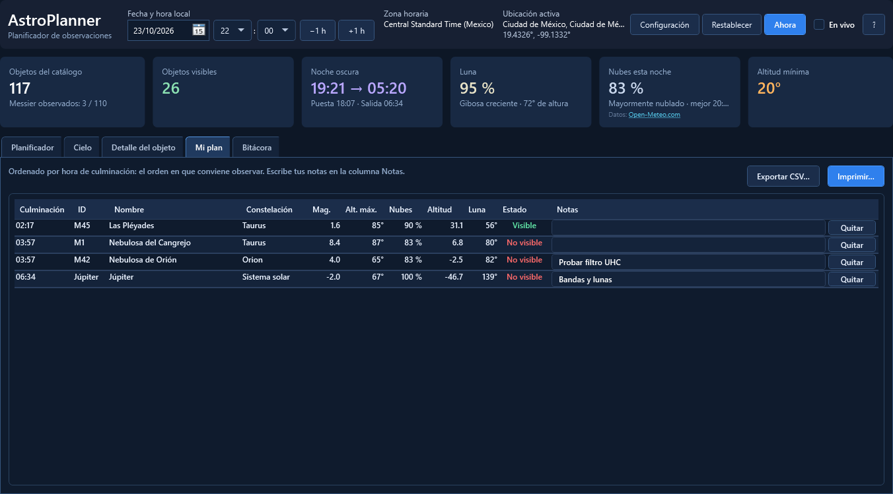
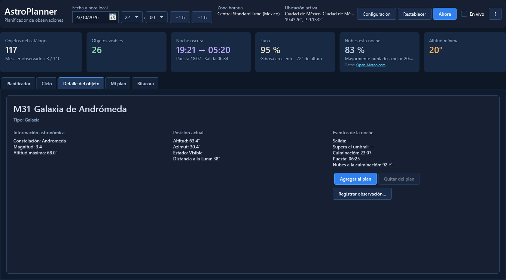
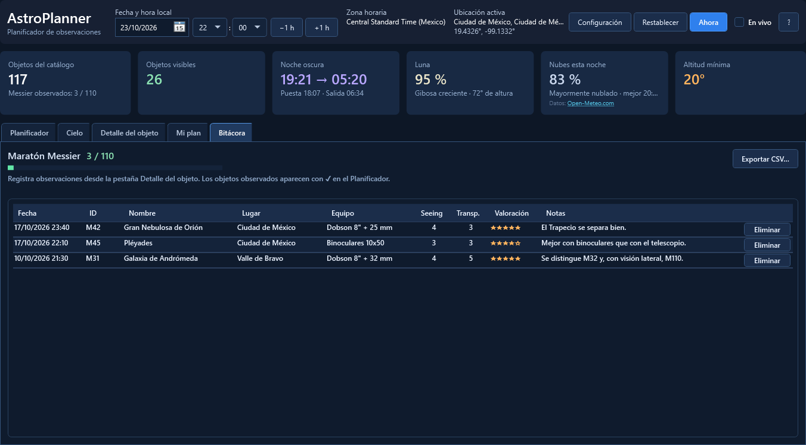

<p align="center">
  
</p>

<h1 align="center">AstroPlanner</h1>

<p align="center">
  <b>Qué ver esta noche, a qué hora y con qué cielo.</b><br>
  Planificador de observaciones astronómicas para Windows.
</p>

<p align="center">
  <a href="https://github.com/Yamato6/AstroPlanner/releases/latest"></a>
  <a href="https://github.com/Yamato6/AstroPlanner/actions/workflows/ci.yml"></a>
  
  
  <a href="LICENSE"></a>
</p>

<p align="center">
  <a href="https://github.com/Yamato6/AstroPlanner/releases/latest"><b>⬇ Descargar para Windows</b></a>
</p>



## Qué hace

- 🔭 **110 objetos Messier y los 7 planetas**: altitud, azimut y si se ven a la hora que elijas, con búsqueda y filtros.
- 🌙 **La noche de verdad**: puesta y salida del Sol, noche oscura, fase de la Luna y aviso cuando su brillo estorba.
- ☁️ **Nubes por hora**: pronóstico de Open-Meteo y la hora más despejada de la noche.
- 🗺️ **Carta del cielo**: qué hay sobre el horizonte y dónde, como al mirar hacia arriba.
- 📋 **Mi plan**: tu lista de la noche en el orden en que conviene observar, con notas, en CSV o impreso.
- 📓 **Bitácora**: registra lo que observas y sigue tu progreso en el maratón Messier.
- ⏱️ **En vivo**: sigue el reloj y lo actualiza todo cada minuto.

Funciona sin conexión; internet solo se usa para las nubes y el aviso de versión nueva, y ambos se pueden desactivar.

## Capturas

| Carta del cielo | Mi plan |
|---|---|
|  |  |
| **Detalle del objeto** | **Bitácora** |
|  |  |

## Instalación

Descarga la [última versión](https://github.com/Yamato6/AstroPlanner/releases/latest) y elige:

| | Archivo | |
|---|---|---|
| **Instalador** (recomendado) | `AstroPlanner_<versión>_Setup.exe` | Menú Inicio, desinstalador y actualizaciones en el mismo lugar. No pide permisos de administrador. |
| **Portátil** | `AstroPlanner_<versión>_win-x64_portable.zip` | Descomprime y ejecuta `AstroPlanner.exe`. |

- Windows 10 u 11 de 64 bits. **No hace falta instalar .NET.**
- Windows puede mostrar *"Windows protegió su PC"* porque el ejecutable no está firmado: pulsa **Más información → Ejecutar de todos modos**. Las sumas SHA-256 de cada versión están en `SHA256SUMS.txt`.
- Tus datos (configuración, plan, bitácora) se guardan en `%LocalAppData%\AstroPlanner`. Actualizar o desinstalar **no los borra**.

## Primeros pasos

1. **Configuración** → elige tu ciudad o escribe tus coordenadas.
2. Elige la fecha y la hora, o pulsa **Ahora**.
3. Selecciona un objeto para ver su curva de la noche y, en **Detalle del objeto**, agrégalo a **Mi plan**.

| Atajo | Acción | Atajo | Acción |
|---|---|---|---|
| `Ctrl+F` | Buscar | `Ctrl+P` | Imprimir el plan |
| `F5` | Hora actual | `Ctrl+E` | Exportar el plan a CSV |
| `Ctrl+,` | Configuración | `F1` | Acerca de |

## Privacidad

AstroPlanner no tiene cuentas ni recopila datos. Solo se conecta a:

- **open-meteo.com**, para el pronóstico, enviando tu ubicación **redondeada a ~1 km**;
- **api.github.com**, para comprobar si hay una versión nueva.

Las dos opciones se desactivan en **Configuración → Conexión a internet**.

## Para desarrolladores

```bash
dotnet build AstroPlanner.slnx
dotnet run --project AstroPlanner.UI
dotnet test AstroPlanner.slnx          # 185 pruebas
```

Requiere el SDK de .NET 10 (el proyecto apunta a .NET 8 LTS). Cada push pasa por el CI; un tag `v*` publica el `.exe`, el instalador y las sumas en un borrador de release.

<details>
<summary><b>Arquitectura</b></summary>

Clean Architecture + MVVM estricto. `AstroPlanner.Core` no depende de la interfaz.

```
AstroPlanner.Core/      Modelos, algoritmos astronómicos e interfaces (sin dependencias de UI)
  ├── Models/             Coordenadas, observador, objetos, Sol/Luna/noche, planetas, clima
  ├── Algorithms/         AstronomyMath, CoordinateTransformer, Precession, Refraction,
  │                       SolarSystemCalculator, PlanetCalculator, TimeZoneConversion,
  │                       ObservationNight
  ├── Services/           AstronomyService
  └── Interfaces/         ICelestialRepository, ICityRepository, IAstronomyService,
                          IWeatherForecastService

AstroPlanner.Data/      Catálogos y datos externos
  ├── Repositories/       Catálogo Messier y ciudades (JSON incrustado), + planetas
  ├── Weather/            OpenMeteoForecastService
  └── SeedData/           messier_objects.json (110 objetos, J2000), cities.json

AstroPlanner.UI/        WPF (.NET 8)
  ├── MainWindow.xaml     Planificador / Cielo / Detalle / Mi plan / Bitácora
  ├── SettingsWindow, LogEntryWindow, AboutWindow
  ├── Themes/Dark.xaml    Paleta y estilos de toda la app (también los colores de los gráficos)
  ├── ViewModels/         MainViewModel (+ .Online: nubes y versión), Settings, Logbook…
  ├── Services/           Persistencia JSON atómica, CSV, impresión, registro, versión,
  │                       enlaces seguros, posición de la ventana, instancia única
  └── Assets/             Icono

AstroPlanner.Tests/     xUnit + FluentAssertions: Core, Data y UI, con pruebas de
                        referencia contra los ejemplos resueltos de Meeus

installer/              Script de Inno Setup
.github/workflows/      CI: compilar (avisos = errores), probar y, con un tag, publicar
```

</details>

<details>
<summary><b>Decisiones de diseño</b></summary>

**Astronomía**
- **Noche de observación:** de la puesta a la salida del Sol (centro a −0,833°); la noche oscura, con el Sol a −18°. Las 02:00 pertenecen a la noche que empezó el día anterior. En latitudes donde el Sol no se pone se usa 18:00 → 06:00.
- **Precisión:** precesión J2000 → fecha (~0,36° en 2026) y refracción estándar (~34' en el horizonte). Sin nutación ni aberración (< 30"); UT en lugar de TT (ΔT ≈ 70 s). La elevación se guarda, pero no interviene en el cálculo.
- **Luna:** fórmulas de baja precisión del Astronomical Almanac (~0,3°) con paralaje y refracción. Estorba si está sobre el horizonte, iluminada ≥ 25 % y a menos de 30° del objeto.
- **Planetas:** elementos keplerianos de JPL (1800-2050) con corrección por tiempo de luz; error ~1' en los interiores y hasta ~10' en Júpiter y Saturno. Magnitudes de Meeus (cap. 41) con los anillos de Saturno (cap. 45).
- **Hora "de pared" → UTC:** se guarda el id de zona horaria de Windows y se convierte con `TimeZoneInfo`. Las horas que no existen por el cambio de horario se desplazan una hora.

**Aplicación**
- **Filtrar no recalcula:** búsqueda y filtros solo filtran; el cielo se recalcula únicamente si cambian la hora, el lugar o la altitud mínima.
- **Modo en vivo con `TimeProvider`:** las pruebas usan un reloj manual; el temporizador vuelve al hilo de la interfaz con el `SynchronizationContext` capturado.
- **Entrada inválida:** `ObservableValidator` con `[Range]`; con un valor fuera de rango se muestra un aviso y se conserva el último cálculo válido.
- **Datos:** JSON en `%LocalAppData%\AstroPlanner`, con escritura atómica (temporal + rename). Una bitácora dañada se aparta como `logbook.corrupto-<fecha>.json` en lugar de sobrescribirse.
- **Errores:** las excepciones no controladas se registran en `logs\` y se avisa sin cerrar la app.
- **Una sola instancia:** abrirla dos veces trae al frente la ventana existente, para que dos procesos no escriban el plan a la vez.
- **Internet opcional:** un único `HttpClient` (15 s). Pronóstico con caché de 1 h por ubicación y 5 min de espera tras un fallo. El aviso de versión solo ofrece pre-releases a quien ya usa una pre-release o una 0.x.
- **Enlaces:** solo se abren direcciones `https` de github.com y open-meteo.com.
- **CSV:** separador y números según la cultura del sistema, UTF-8 con BOM, para que Excel lo abra bien.

**Compilación**
- **.NET 8 LTS** como destino, compilado con el SDK 10.
- **Un único `.exe` autocontenido y comprimido** (~76 MB en lugar de ~175 MB, a cambio de ~0,2 s más al abrir). Los catálogos van incrustados.
- **NU1701 suprimido:** lo provoca `SkiaSharp.Views.WPF` (dependencia de ScottPlot), que solo declara .NET Framework pero funciona en .NET 8.

</details>

<details>
<summary><b>Dependencias</b></summary>

| Proyecto | Paquete | Versión |
|---|---|---|
| UI | CommunityToolkit.Mvvm | 8.4.2 |
| UI | Microsoft.Extensions.DependencyInjection | 10.0.13 |
| UI | ScottPlot.WPF | 5.1.59 |
| Tests | xunit · xunit.runner.visualstudio | 2.9.3 · 3.1.4 |
| Tests | FluentAssertions | 8.11.0 |
| Tests | Microsoft.NET.Test.Sdk · coverlet.collector | 18.11.0 · 6.0.4 |

</details>

## Historial

Los cambios de cada versión están en el [CHANGELOG](CHANGELOG.md).

## Créditos y licencia

- Pronóstico de nubes: [Open-Meteo.com](https://open-meteo.com/) (datos bajo [CC BY 4.0](https://creativecommons.org/licenses/by/4.0/)).
- Algoritmos: Jean Meeus, *Astronomical Algorithms* (2.ª ed.), y elementos orbitales aproximados del JPL (NASA).
- Gráficos: [ScottPlot](https://scottplot.net/).

© 2026 Yamato6 · [Licencia MIT](LICENSE)
